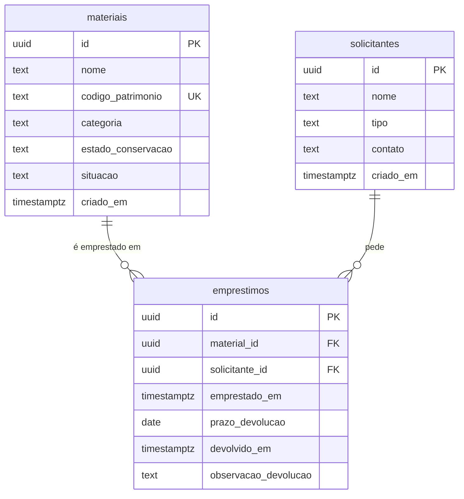

# Modelo de dados e back-end (Supabase)

Aula 3. O script completo e comentado pelo próprio SQL está em [`supabase/schema.sql`](../supabase/schema.sql), e os dados de exemplo em [`supabase/seed.sql`](../supabase/seed.sql).

## Entidades

O empréstimo é uma entidade própria, ligando material, solicitante, datas e prazo. Isso deixa o caminho aberto para a evolução futura (aluguel) sem colocar preço, reserva ou pagamento no MVP.

## Regras que ficam no banco

O front-end valida só o formato (UX). A integridade fica no banco, para valer mesmo que alguém use a API direto.

| Regra | Como o banco garante |
|---|---|
| Código de patrimônio único | `unique` em `materiais.codigo_patrimonio` |
| Valores permitidos (conservação, situação, tipo) | `check` nas colunas |
| Só materiais disponíveis podem ser emprestados | Trigger `emprestimo_antes_de_inserir` recusa o insert |
| Um material tem no máximo 1 empréstimo aberto | Índice único parcial `where devolvido_em is null` |
| Prazo não pode ser anterior a hoje | Mesmo trigger, usando o fuso de São Paulo |
| Material muda para Emprestado ao registrar o empréstimo | Mesmo trigger, na mesma transação |
| Material volta a Disponível ao devolver | Trigger `emprestimo_antes_de_atualizar` |
| Data e hora da devolução automáticas | O trigger substitui o valor enviado por `now()` |
| Empréstimo não pode ser devolvido duas vezes | O trigger recusa alterar um empréstimo já devolvido |
| Material com empréstimo (aberto ou histórico) não é excluído | `on delete restrict` nas chaves estrangeiras |

A última regra é um pouco mais forte que o RF03, que só pede bloquear a exclusão com empréstimo em aberto. Bloquear também o histórico evita perder o registro de quem pegou o quê.

## Segurança (RLS)

A RLS está habilitada nas 3 tabelas, e cada tabela só tem as políticas de que o front-end precisa:

| Tabela | Políticas |
|---|---|
| `materiais` | leitura, inserção, atualização, exclusão |
| `solicitantes` | leitura, inserção |
| `emprestimos` | leitura, inserção, atualização (não há exclusão) |

As políticas valem para os papéis `anon` e `authenticated` porque o protótipo ainda não tem login. Isso significa que quem tiver o link do site e a chave pública consegue ler e alterar os dados. Quando o login for implementado (RNF05), troque `to anon, authenticated` por `to authenticated` nas políticas.

## Roteiro de teste do CRUD

Para confirmar no navegador e no Table Editor do Supabase:

- [ ] Insert: cadastrar 3 materiais pela tela Cadastro (ou rodar o `seed.sql`).
- [ ] List: abrir a tela Materiais e ver os 3.
- [ ] Update: editar o nome de 1 material e conferir no Table Editor.
- [ ] Delete: excluir 1 material e conferir que sumiu.
- [ ] Regra do banco: registrar um empréstimo e tentar excluir o material (deve ser bloqueado).
- [ ] Regra do banco: tentar emprestar o mesmo material duas vezes seguidas (a segunda deve falhar com mensagem clara).
